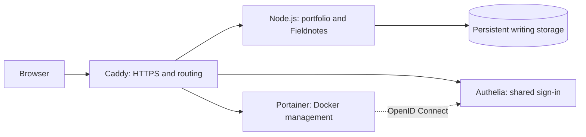

# Rithvik’s portfolio

**A portfolio, a publishing space, and a self-hosted engineering project.**

A home for my work across full-stack development, cloud infrastructure, and machine learning. Explore the projects, read what I’m learning, or look behind the scenes at the application and deployment code that run this site on Oracle Cloud.

[**Visit the portfolio →**](https://rithvik.ddns.net/) · [Projects](https://rithvik.ddns.net/Projects.html) · [Blog](https://rithvik.ddns.net/blog/) · [Learning notebook](https://rithvik.ddns.net/learn/)

[Run locally](#run-locally) · [How it works](#how-it-works) · [Deploy to production](#deploy-to-production) · [Documentation](#documentation)

## What’s inside

| Experience | What it offers |
| --- | --- |
| **Explore the work** | Searchable projects, professional experience, credentials, recognition, and a downloadable CV. |
| **Read and publish** | Fieldnotes combines a public blog and learning notebook with a private Markdown editor, drafts, publishing, tags, export, and recoverable trash. |
| **Get in touch** | A contact form with email delivery, validation, and rate limits. |
| **Manage the server** | A private dashboard and Portainer share an Authelia sign-in. Editing and container management stay behind authentication. |
| **Ship updates** | Merging a PR into `main` starts a GitHub Actions deployment, with configuration checks, tests, and live endpoint checks. |

The interface uses semantic HTML, custom CSS, and vanilla JavaScript. Public portfolio content and navigation work without JavaScript; motion respects reduced-motion preferences and a saved visitor setting. Fonts and assets are served locally.

## How it works

Generated portfolio pages and a Node.js backend run together in one app container. Caddy handles HTTPS and routing, Authelia handles shared sign-in, and Portainer manages Docker. All four services run through Docker Compose on the Oracle AMD server.



Only Caddy publishes web ports. Administrator and Portainer routes require authentication; public portfolio pages and published writing remain open to visitors.

| Layer | Tools |
| --- | --- |
| Public interface | Generated HTML, custom CSS, vanilla JavaScript, local SVG illustrations |
| Application | Node.js 24 in Docker, Nodemailer, Markdown rendering and HTML sanitization |
| Access and routing | Caddy HTTPS, Authelia, Portainer OpenID Connect |
| Hosting and delivery | Oracle Cloud AMD, Docker Compose, GitHub Actions, SSH |

## Run locally

With Node.js 24 and pnpm installed, run these commands from the repository root:

```sh
pnpm install --frozen-lockfile --ignore-scripts
node scripts/build.mjs
node scripts/check.mjs
node --test tests/*.test.mjs
node --env-file-if-exists=.env server/index.mjs
```

Open **http://127.0.0.1:4173**. Stop the server with Ctrl+C. Equivalent pnpm commands are `pnpm build`, `pnpm check`, `pnpm test`, and `pnpm dev`. Build and content checks still run without installing dependencies; running the server requires the installed dependencies. The old `node scripts/serve.mjs` preview command also works, but does not automatically load `.env`.

Copy `.env.example` to `.env` and fill in your SMTP provider settings to enable delivery locally. Do not commit this file. Without SMTP configuration, contact form submission is disabled. Tests use fake delivery functions and never send real email. Change both `PORT` and `PUBLIC_ORIGIN` if using a different preview port. The form must be tested through HTTP/HTTPS, not by opening an HTML file directly.

This local command previews the public portfolio, empty writing collections, and contact API. It does not start Caddy or Authelia; `/admin/` remains closed by default. Use the production setup for the complete sign-in flow.

Prefer Docker? Run `docker compose up --build -d --wait` and open **http://localhost:8080**. See the [container guide](deploy/DOCKER.md) for runtime settings.

The deployment image-retention tests use Python’s standard library and a fake Docker client:

```sh
python3 -m unittest discover -s tests -p 'test_deploy_images.py'
```

## Write posts and learning notes

Open [Fieldnotes](https://rithvik.ddns.net/admin/notes/) using your existing login. Save drafts manually (or Ctrl+S / Cmd+S); select Publish when ready to share. Entries are saved in private Oracle `.notes/` storage, survive redeployment, and do not require Git commits. See the [writing guide](deploy/FIELDNOTES.md) for the full workflow and limits.

## Update the content

- Edit `data/portfolio.json` for roles, descriptions, projects, skills, credentials, education, and contact details.
- Each project separates `technologies` (languages, libraries, and tools) from `skills` (the technical approaches demonstrated). Leave `technologies` empty when a stack is not specified.
- The toolkit displays skills as plain text tags. Project cards retain their own applied skills and tools.
- `professionalAwards` and `awards` appear together in one Honors & recognition section, with general honors first, followed by professional awards. Optional `scope`, `date`, `description`, and `image` fields supply labels and details; missing details are omitted. Homepage recognition links lead to this shared collection.
- Replace `documents/Rithvik_CV.pdf` to update every CV download. That alone does not change the text on the pages; update the content file for changes to roles or other details.
- Run `node scripts/build.mjs` after content or template edits. It regenerates `index.html`, `Projects.html`, `Awards.html`, `404.html`, `error.html`, and `sitemap.xml`.
- Run `node scripts/check.mjs` to validate local links, anchors, document structure, and the PDF download.
- Commit the generated pages alongside the content and the current CV. Generated HTML should not be edited directly.

## Deploy to production

1. Commit and push your changes to `V2`.
2. Open a pull request into `main` and merge it when ready.
3. Follow the [Deploy portfolio workflow](https://github.com/RithvikRS/Portfolio-website/actions/workflows/deploy.yml) until the deployment succeeds.

A push to `V2`, a closed but unmerged PR, or a direct push to `main` does not trigger this workflow. The [workflow file](.github/workflows/deploy.yml) uses the trusted `main` context and connects over SSH to run `/opt/portfolio/portfolio_redeploy.sh`. GitHub supplies `SSH_HOST`, `SSH_USER`, `SSH_PRIVATE_KEY`, and `SSH_KNOWN_HOSTS` from the `production` environment, which is restricted to `main`. It does not check out or execute unmerged PR code.

The server fetches the latest `main`, updates its checkout with a fast-forward merge, validates Compose/Authelia/Caddy, and builds the app image. The build generates pages, checks links, and runs tests. The script then updates services, reconciles Portainer SSO, reloads Caddy, and checks public endpoints and private access gates. A conflicting server edit stops the deployment for reconciliation.

Git updates tracked source files, including removing files deleted in `main`; it does not wipe the server directory. Docker replaces containers as needed. `.env.production`, `.auth/`, `.portainer/`, `.notes/`, and Caddy certificate volumes persist. The existing app serves during the build, but container replacement may briefly interrupt requests. Authelia restarts, so sign in again afterward.

For a manual deployment, run **inside Oracle SSH**:

```sh
bash /opt/portfolio_redeploy.sh
```

The existing shortcut runs the repository script. Use `bash /opt/portfolio_redeploy.sh --no-pull` to rebuild the current server checkout after a server-only settings change. Local `.env` edits do not update Oracle’s `.env.production`.

### Image cleanup and rollback

After **all deployment checks pass**, the script retains successful app images and cleans up older ones:

| Image tag | What it represents |
| --- | --- |
| `rithvik-portfolio:production` | Most recently built candidate; it may not have passed deployment checks. |
| `rithvik-portfolio:current` | Last app image to pass the complete deployment checks. |
| `rithvik-portfolio:previous` | Previous successful app image, retained for manual rollback. |

Cleanup removes unused, untagged portfolio images and eligible retired rollback images. Explicit backup tags and other applications’ images are preserved. The default builder’s shared cache is pruned toward **256 MB**; records still in use may keep it above that target. Future builds can take longer as cache is rebuilt. Runtime data, volumes, and containers are preserved.

A failed build, startup, or endpoint check does not rotate the recovery tags or run cleanup. There is **no automatic rollback**. Use the [manual rollback instructions](deploy/DOCKER.md#image-cleanup-and-rollback) to restore the previous app image without rebuilding. This restores the app only; configuration and stored data stay at their current versions. A fresh installation gains a previous image after a second distinct image succeeds.

**First rollout of cleanup:** after merging this change and allowing its deployment to finish, re-run that successful GitHub Actions run once, or run `bash /opt/portfolio_redeploy.sh --no-pull` on Oracle. The first run finishes the script version loaded before Git updated it; the next run activates the new retention and cleanup steps. Later deployments use them automatically.

## Documentation

| Guide | Start here for |
| --- | --- |
| [Docker and Oracle operation](deploy/DOCKER.md) | Setup, deployment, cleanup, rollback, Caddy routing, and troubleshooting |
| [Admin dashboard and shared login](deploy/ADMIN.md) | Account access, password recovery, persistent data, and backups |
| [Portainer and SSO](deploy/PORTAINER.md) | Container management, recovery access, and storage |
| [Blog and learning notebook](deploy/FIELDNOTES.md) | Drafts, publishing, exports, backups, and recovery |
| [Alternative host deployment](deploy/README.md) | Node and Caddy with systemd, without the Docker stack |
| [Docker and Caddy PDF guide](output/pdf/Portfolio%20Docker%20and%20Caddy%20Guide.pdf) | A printable setup reference; use the Markdown guide for current deployment procedures |

## Current deployment

Deployment record updated **19 October 2026 (Asia/Kolkata)**. Oracle serves production from `/opt/portfolio` on `main` at `rithvik.ddns.net`; Caddy supplies HTTPS. **GitHub Pages is disabled.**

| Resource | Address | Access |
| --- | --- | --- |
| Public portfolio | [rithvik.ddns.net](https://rithvik.ddns.net/) | Public, with SMTP configured |
| Blog / learning notebook | [/blog/](https://rithvik.ddns.net/blog/) / [/learn/](https://rithvik.ddns.net/learn/) | Published entries only |
| Admin dashboard | [/admin/](https://rithvik.ddns.net/admin/) | Login required |
| Shared sign-in | [/auth/](https://rithvik.ddns.net/auth/) | Authelia, username/password |
| Portainer | [/portainer/](https://rithvik.ddns.net/portainer/) | Shared login |
| Fieldnotes editor | [/admin/notes/](https://rithvik.ddns.net/admin/notes/) | Shared login |

<details>
<summary>Deployment verification and recovery history</summary>

The automatic deployment completed successfully on 19 October. The server checkout matched `main`; public portfolio, contact, writing, and auth health endpoints returned HTTP 200, and private routes rejected signed-out requests. The cleanup feature described above requires its first-rollout step. This is a verification record, not continuous uptime monitoring.

The original dashboard deployment passed 15 automated tests, live sign-in/sign-out and access checks, and desktop/mobile review. Fieldnotes passed 19 tests, browser save/preview/publish/unpublish checks, shared-login and privacy checks, and persistence after an app restart. Contact checks confirmed configured delivery without sending email.

Following an outage and reboot on 8 October, the public site and full Portainer SSO flow were verified again. Logs showed repeated host memory exhaustion in `dnf-makecache.service`; its background cache timer is disabled on Oracle, while package updates remain available. See the [incident and recovery record](deploy/DOCKER.md#8-october-2026-memory-exhaustion-and-recovery).

</details>

## Repository map

- `server/notes.mjs`, `server/notes-store.mjs`, `js/notes.js`, `css/notes.css`: the authenticated editor, private/published content store, and public writing pages.
- `scripts/setup-notes.py`: prepares private writing storage during deployment.
- `scripts/build.mjs`: shared HTML templates and page generation.
- `css/site.css`: colors, type, component styles, responsive layout, print styles, and reduced-motion support.
- `js/site.js`: mobile navigation, project filters/search, linked project expansion, accessible contact dialog, active navigation, and scroll entrance animations.
- `server/`: public-file allowlist, protected dashboard, same-origin contact API, validation, rate limits, duplicate-submission protection, and SMTP delivery. Recipient and credentials remain in server configuration. Visitor addresses are used for Reply-To only.
- `server/admin.mjs` and `css/admin.css`: dashboard markup, administrator identity checks, and responsive styling.
- `Dockerfile`: builds and tests the Node application image; Compose decides how to run it.
- `compose.yaml`, `compose.ip.yaml`, and `compose.production.yaml`: separate local, temporary public-IP, and production configurations. Use one at a time for a deployment.
- `.github/workflows/deploy.yml`: starts an SSH deployment when a PR is merged into `main`.
- `portfolio_redeploy.sh`: pulls `main`, validates configuration, builds the app, starts services, checks the public endpoints, and then retains rollback images and cleans unused portfolio images/build cache.
- `scripts/deploy-images.py` and `compose.rollback.yaml`: preserve the last successful app images and support [app-only rollback](deploy/DOCKER.md#image-cleanup-and-rollback).
- `tests/`: Node application tests and Python image-retention tests, with fake mail delivery and Docker operations.
- `scripts/setup-admin.py`: one-time Linux administrator setup. It generates private account files and refuses to replace an existing `.auth/` directory.
- `scripts/setup-portainer.py`: prepares private Portainer/OIDC files without replacing existing credentials, then applies SSO settings and checks Docker access during redeployment.
- `deploy/Caddyfile.docker` and `deploy/authelia/configuration.yml`: production routing and non-secret authentication settings.
- `deploy/Caddyfile` and `deploy/portfolio.service`: alternative host-based templates, not the active Docker deployment.
- `images/favicon.svg`: local vector identity. The hero illustration and project diagrams use inline SVG/CSS.

## Hosting and private data

The production Compose file runs the complete Oracle stack. SMTP credentials are supplied at runtime; private authentication, Portainer, and writing data live in `.auth/`, `.portainer/`, and `.notes/`. Keep these directories, `.env`, `.env.production`, passwords, and SSH keys out of Git and the image build context.

Generated portfolio pages can also be served by a static host, but the contact backend, dashboard, authentication, and Fieldnotes require server processes. The [host-based guide](deploy/README.md) covers an alternative Node/systemd setup for the public portfolio and SMTP backend; it does not install shared login.

For Docker production, change `DOMAIN` in the server's `.env.production` and redeploy when moving to a new domain. Compose derives the public origin, build URL, and authentication URLs from it. For static or direct Node hosting, update `siteUrl` in the content file and rebuild. See [domain changes](deploy/DOCKER.md#changing-the-domain) for details.

The contact form keeps the destination email address in server configuration. Downloadable documents and repository history may contain contact details independently of what appears on the public pages.

The existing `Projects.html`, `Awards.html`, and original homepage anchors are retained.
