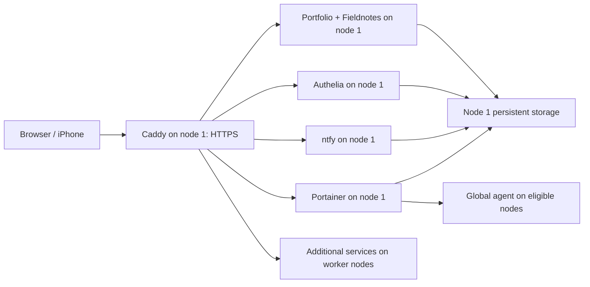

# Operate and extend the production Swarm

Run manager commands as `opc` on node 1 in `/opt/portfolio`. Make public configuration changes locally, push to `V2`, and merge a PR into `main`. Do not make persistent service edits through Portainer: the next deployment restores the Git configuration.

[Architecture](#architecture) | [Add a service](#add-a-stateless-service) | [Storage](#add-a-service-with-persistent-storage) | [Configuration](#update-configuration) | [Add nodes](#add-a-worker-node) | [Maintenance](#maintain-or-remove-a-node) | [Rollback](#roll-back)

## Architecture

AMD node 1 is the manager, data host, build host, and public ingress. AMD node 2 and Ampere A1 are workers. Additional Linux workers can join without changing a node count in Python.

| Node | Hostname | Swarm role | Placement label | Workload |
| --- | --- | --- | --- | --- |
| AMD node 1 | `vantize-micro-amd` | Manager | `portfolio.data=true` | Core services, data, builds and ingress |
| AMD node 2 | `vantize-micro-amd-2` | Worker | `portfolio.worker=true` | Authenticated demo |
| Ampere A1 | `vantize-ampere-a1` | Worker | `workload.compute=true` | ARM64 compute capacity, 4 OCPUs / 24 GB RAM |

Node membership and labels live in Swarm manager state. Git stores service placement constraints and this runbook; merging does not join nodes or recreate labels. The global Portainer agent runs on all three nodes. Ampere starts with only that agent until you add a compute service to the catalog. Keep its compute label separate from `portfolio.worker=true` so the existing demo stays on AMD node 2.

| Service | Placement | Persistent state |
| --- | --- | --- |
| app | Node 1 | `.notes/` |
| auth | Node 1 | `.auth/` |
| ntfy | Node 1 | `.ntfy/` |
| portainer | Node 1 | `.portainer/` |
| caddy | Node 1 | `portfolio_caddy_data`, `portfolio_caddy_config` |
| node2 demo | A node with `portfolio.worker=true` | None |
| agent | Every eligible Linux node | Docker socket/volume access for Portainer |
| Additional services | Their catalog placement constraints | Explicit mounts, if configured |



Only Caddy publishes application ports: 80/TCP and 443/TCP+UDP on node 1. DNS stays pointed at node 1. Private overlay networks connect services across nodes. The `swarm_backend` network, `10.42.0.0/24`, is exclusive to Caddy and the portfolio app because the app trusts identity headers from that subnet. Each additional service uses catalog networks; attach Caddy only when it needs to proxy that service.

Keep `portfolio.data=true` on node 1 only. Core services each use one replica and stop-first updates. Additional services with writable bind mounts or volumes must also use one stop-first replica on the data node. This prevents simultaneous writers; it does not replicate storage.

There is no automatic data failover. Losing node 1 stops ingress and the stateful services, and the single manager cannot schedule replacements while offline. Adding workers does not solve this. Plan manager quorum, storage replication, application consistency, and ingress together before enabling failover.

## Which file controls what?

| File | Purpose |
| --- | --- |
| `compose.production.yaml` | Settings for the five core services; input to the Swarm renderer |
| `deploy/swarm.json` | Dedicated proxy subnet, data-node constraint, Portainer agent image |
| `deploy/swarm-services.json` | Additional services, including `node2`; their networks, resources, storage and route checks |
| `deploy/Caddyfile.swarm` | Live HTTPS routing and forward authentication |
| `deploy/authelia/configuration.yml` | Access rules and shared sign-in configuration |
| `deploy/ntfy/server.yml` | ntfy server configuration |
| `.env.production` | Private core service environment values on node 1 |
| `.swarm/services.private.json` | Optional private environment values for catalog services |
| `.secrets/` | Optional private source files for catalog Docker secrets |
| `.services/` | Optional private bind data for new stateful services |
| `.swarm/releases/` | Private rendered stacks, versioned configs/secrets, and checks for each release |

Use `compose.production.yaml` only as renderer input on production. Do not run `docker compose up` there. New services belong in the catalog; the renderer rejects extra core-Compose services rather than silently dropping them. The legacy `Caddyfile.docker` does not control Swarm routing.

## Add a stateless service

Example: add a second authenticated diagnostic endpoint at `/tools/echo/`. This uses the existing demo image and needs no database. Merge the following entries into `deploy/swarm-services.json`; keep existing entries and valid JSON commas.

Add inside `services`:

```json
"echo": {
  "image": "traefik/whoami@sha256:c4717a8d1f0134a7444e24f881160e033991f23027c6c5a9a3f8fd22e70d1d44",
  "networks": ["swarm_echo"],
  "read_only": true,
  "cap_drop": ["ALL"],
  "deploy": {
    "replicas": 2,
    "placement": {"constraints": ["node.labels.portfolio.worker == true"]},
    "resources": {"limits": {"memory": "64M"}}
  }
}
```

Add `"swarm_echo": {"driver": "overlay", "attachable": false}` inside `networks`, and append `"swarm_echo"` to `caddy_networks`. Replicas may share one worker; adding workers does not automatically rebalance existing tasks. Use placement preferences or `max_replicas_per_node` only after ensuring enough eligible nodes exist. Memory limits are ceilings, not reservations; add `deploy.resources.reservations` when you need scheduler capacity guarantees.

For a private route, add this block inside the main `{$DOMAIN}` site in `deploy/Caddyfile.swarm`, before its final fallback `handle`:

```caddyfile
@echo path /tools/echo /tools/echo/*
handle @echo {
    route {
        forward_auth auth:9091 {
            uri /api/authz/forward-auth?authelia_url=https://{$DOMAIN}/auth/
        }
        uri strip_prefix /tools/echo
        reverse_proxy echo:80
    }
}
```

Append `'^/tools/echo(/.*)?$'` to the admin rule's `resources` in `deploy/authelia/configuration.yml`. Do not change the default deny policy. This example checks browser access but does not make the application trust identity headers. Add identity integration only if the application supports it and configure its trusted proxy boundary explicitly.

Append `{"url": "https://{DOMAIN}/tools/echo/", "statuses": [302, 303, 401]}` to `http_checks`, and `"http://echo:80"` to `internal_checks`. The public check tests the authentication gate without following redirects; the internal check tests the upstream from Caddy. Both must pass. For a deliberately public route, omit forward authentication and use an appropriate expected status such as 200. For a new hostname, configure DNS, Caddy, and Authelia's domain/session rules as needed; use its literal HTTPS URL in the check.

For other images, select an upstream version/digest, use its real internal port, and add its documented container health check. A path prefix works only if the application supports that deployment; otherwise use a hostname. Keep host ports unpublished. New catalog services cannot join core networks or replace core service names.

Build custom images separately and publish them to a registry reachable by each eligible node. The workflow builds the portfolio image in GitHub Actions for AMD64 and ARM64; its running service stays pinned to node 1. Manual deployments without a CI image still build locally. Catalog services do not support `build`. The renderer pins the configured registry repository by digest and never substitutes a local backup alias. For a private registry, arrange Docker registry authentication on every eligible node; the workflow does not forward registry credentials automatically. Check image support for every target architecture before adding ARM workers; keep `node.platform.arch` constraints until the image and agent support those nodes.

## Target Ampere compute services

Follow the service catalog, network, route and check steps above. For an ARM64-compatible service, use this placement block in `deploy/swarm-services.json`:

```json
"placement": {
  "constraints": [
    "node.labels.workload.compute == true",
    "node.platform.arch == aarch64"
  ]
}
```

Swarm reports this host architecture as `aarch64`; the corresponding container image platform is `linux/arm64`. Select a multi-platform registry digest that includes ARM64. The renderer also pulls images on the AMD manager, so use a manifest supporting both `linux/amd64` and `linux/arm64` with the current pipeline. Keep the locally built portfolio app pinned to node 1.

Set memory limits and reservations for each compute service and leave capacity for Docker and the agent. Ampere is currently the only compute-labeled node. Its services remain pending if it is drained or unavailable. Keep writable persistent services on node 1 under the current storage guard. Extend backup image/platform coverage before relying on ARM image restores; the private PC exporter currently saves AMD64 images.

To restore the compute label after rebuilding and rejoining Ampere, run on node 1:

```sh
sudo docker node update --label-add workload.compute=true vantize-ampere-a1
sudo docker node inspect vantize-ampere-a1 --format '{{json .Spec.Labels}}'
```

## Catalog format and limits

The catalog uses Docker stack service syntax expressed as JSON, not full modern Compose syntax. Top-level keys are `services`, `networks`, `caddy_networks`, `volumes`, `configs`, `secrets`, `http_checks`, and `internal_checks`.

Supported service fields: `image`, `command`, `entrypoint`, `user`, `environment` (object), `read_only`, `healthcheck`, `stop_grace_period`, `logging`, `cap_drop`, `cap_add`, `tmpfs`, `deploy`, `networks` (array), `volumes` (long syntax), `configs`, `secrets`, `working_dir`, `hostname`, `dns`, `dns_search`, and `extra_hosts`. Unknown fields fail validation. Set explicit placement constraints and a memory limit for each service. Supported modes are `replicated` and `global`; jobs are not supported.

Update/restart policies default to one-at-a-time stop-first updates, pause on update failure, and restart on any exit. `deploy.replicas: 0` intentionally disables a replicated service. A global service must have at least one eligible target; checks use Docker's desired task count as nodes join or drain.

Catalog strings are literal: `${VARIABLE}` is not expanded from `.env.production`. The renderer escapes dollar signs for Docker. Use private overrides or Docker secrets for credentials. Optional checks accept HTTPS URLs with `{DOMAIN}` or `{NTFY_DOMAIN}` placeholders and expected HTTP status arrays. Internal HTTP checks run from Caddy, so Caddy must share the service network. Do not put credentials in check URLs. Services that are scaled to zero must have their route checks removed too.

## Add a service with persistent storage

Choose its state directory, backup procedure, image version, and restore process before enabling it. New persistent data is not automatically added to the existing private PC backup. Extend and test that backup's service quiescing, mount inventory, archives, and restore instructions first; see [BACKUPS.md](BACKUPS.md#extend-backup-coverage-for-new-services).

For an external volume, create it on node 1:

```sh
sudo docker volume create portfolio_example_data
```

Add `"example_data": {"external": true, "name": "portfolio_example_data"}` under catalog `volumes`, and use this mount in the new service:

```json
"volumes": [
  {"type": "volume", "source": "example_data", "target": "/data"}
],
"deploy": {
  "replicas": 1,
  "placement": {"constraints": ["node.labels.portfolio.data == true"]},
  "resources": {"limits": {"memory": "128M"}},
  "update_config": {"parallelism": 1, "order": "stop-first", "failure_action": "pause"},
  "rollback_config": {"parallelism": 1, "order": "stop-first"}
}
```

Replace `/data` with the image's documented data path and size memory for the application. A bind alternative uses `{"type":"bind","source":"/opt/portfolio/.services/example","target":"/data"}`. Create the directory on node 1 with the ownership and mode required by the image before deploying. Read-only bind files must exist on every eligible node; prefer Swarm configs/secrets for distributing small files.

Do not label another node as the data node or scale a local database to multiple replicas. Volumes with the same name on separate nodes are separate storage. Removing a service does not delete its external volume or bind data.

## Update configuration

For existing or new services, use this sequence: edit the appropriate source, validate locally, push V2, merge, inspect the workflow and service tasks, then check application behavior. Do not edit generated files in `.swarm/releases`.

| Change | Where to make it | How it takes effect |
| --- | --- | --- |
| Core environment/image/limits | `compose.production.yaml` | Rendered into the next stack update |
| Catalog image, replicas, limits, placement | `deploy/swarm-services.json` | Next deployment reconciles the service |
| Public routing | `deploy/Caddyfile.swarm` plus catalog `caddy_networks` | A versioned Docker config restarts Caddy |
| Access rule | `deploy/authelia/configuration.yml` | A versioned config updates Authelia; sessions may expire |
| Core private environment | `.env.production` on node 1 | Redeploy the current checkout deliberately |
| Catalog private environment | `.swarm/services.private.json` on node 1 | Merge into that service's environment on next deployment |
| Catalog config/secret file | A declared source file or versioned external resource | New immutable resource reference updates the service |

### Public config files

Store non-secret configuration under `deploy/`. For example, declare `"example_settings": {"file":"deploy/example/settings.conf"}` under catalog `configs`, then add `"configs": [{"source":"example_settings","target":"/etc/example/settings.conf"}]` to the service. The renderer copies the bytes into the private release and uses a content-hashed Docker config name. Editing the source creates a new version; rollback uses the earlier saved bytes. This avoids bind-mounted files changing under running containers without a controlled restart.

### Private environment values and secrets

On node 1, keep `.swarm/services.private.json` mode 600 with this structure (replace the example values privately):

```json
{"example": {"API_TOKEN": "replace-on-server", "LOG_LEVEL": "info"}}
```

Only configured catalog service names are accepted. These values override the service's public environment. Environment credentials remain visible to Docker administrators through service inspection. They are saved in private release snapshots, not Git.

Prefer Docker secrets when the application supports reading a file. Create its source on node 1 using a private editor session:

```sh
cd /opt/portfolio
umask 077
mkdir -p .secrets
chmod 700 .secrets
nano .secrets/example-token
chmod 600 .secrets/example-token
```

Enter the credential in the editor, not in a shell command or Git file. Then declare `"example_token": {"file":".secrets/example-token"}` under catalog `secrets`. Attach `"secrets": [{"source":"example_token","target":"api_token"}]` to the service, and set the application's supported file setting, for example `API_TOKEN_FILE=/run/secrets/api_token`. A `_FILE` setting works only if the application implements it.

The renderer snapshots file-backed secrets into the private release, creates a content-hashed Swarm secret, and preserves the mount target. It also accepts `{"external":true,"name":"example_token_v1"}` for a pre-created Docker secret/config. Create a new versioned external name when rotating; keep old versions for rollback. Do not delete old Docker configs/secrets or release folders until their rollback/backup retention has expired. Secret names and content hashes are metadata, not encryption; keep source files and releases private.

Public settings go through Git. Private-only changes can be applied deliberately on node 1 with:

```sh
cd /opt/portfolio
python3 scripts/swarm-deploy.py deploy
```

This does not pull Git. It builds and validates before updating services. To validate and render without updating running services, use `python3 scripts/swarm-deploy.py prepare`; it still builds/pulls images, writes a private candidate, and runs isolated validation containers. `apply` deploys that prepared candidate; do not run it if the source/private settings have changed since preparation.

### Changing the domain

Configure the new DNS record to point at node 1, then update `DOMAIN` privately in `.env.production`. Update `NTFY_DOMAIN` separately if moving ntfy. Update any literal hostnames in catalog HTTP checks and application callback/origin settings through Git. Deploy the reconciled source: the renderer supplies the core Caddy/Authelia environment, the app build URL, and Portainer trusted/OAuth origins. Check the new certificate, sign-in callback, public pages, and private routes before removing old DNS. Update the iPhone server/user subscription if ntfy moves. Keep local portfolio content `siteUrl` consistent for previews and generated assets.

### Remove a service

Remove its catalog service, route, access rule, dedicated network/Caddy attachment, checks, and private environment override together. Keep data and backup copies. Deployment uses `docker stack deploy --prune` to remove services absent from the target release; rollback also prunes services introduced by the failed/newer release. Only put Git-managed services in the `portfolio` stack. Unrelated stacks are unaffected. External volumes/configs/secrets remain until explicitly retired.

## Add a worker node

1. Install a compatible Docker Engine on the new Linux server. Use a private IP reachable by the other nodes. Check RAM/disk capacity and image architecture support. Keep public SSH restricted to your normal administrative access.
2. In both Oracle security lists/NSGs and each host firewall, permit **bidirectional peer traffic** for 7946/TCP+UDP and 4789/UDP among all Swarm nodes. Permit 2377/TCP from workers to the manager. Add the new private IP to existing nodes' peer rules as well as the reverse rules on the new node. Do not open these ports to the Internet. New workers need no public web ports for this host-mode Caddy layout.
3. On node 1, retrieve the worker join command privately:

   ```sh
   sudo docker swarm join-token worker
   ```

   On the new node, run the returned command using node 1's private address (`10.0.0.249:2377` in the current setup). Add `--advertise-addr <new-private-ip>` and `--data-path-addr <new-private-ip>` if needed to select the private interface. Keep join tokens out of Git, screenshots, and workflow logs.
4. On node 1, inspect the hostname and choose the workload pool. For another compute worker:

   ```sh
   sudo docker node ls
   sudo docker node update --label-add workload.compute=true <new-node-name>
   ```

   Never add `portfolio.data=true` to a worker. Use `portfolio.worker=true` only when you intend the node to run the existing demo pool. Labels select workloads independently of the Swarm worker role. An additional label such as `workload.tools=true` can select a narrower pool. A service constraint `node.hostname == <name>` pins it to one machine; a shared label allows scheduling across that pool.
5. The global Portainer agent should start automatically on the new eligible Linux node. It uses the private overlay and shared agent secret; do not install a separate agent or publish 9001. If adding a different architecture, verify the pinned agent image has that platform before expecting the task to start.
6. Run the checks below from node 1, then open Portainer's **Oracle Swarm** environment. The helpers compare discovered node IDs and desired task counts; there is no fixed two-node limit.

   ```sh
   sudo docker node ls
   sudo docker service ps portfolio_agent --no-trunc
   python3 scripts/swarm-deploy.py check
   python3 scripts/swarm-portainer.py
   ```

Joining adds capacity; it does not increase a service's replica count. Change catalog replicas and merge to use more instances. Check distributed services from Caddy and verify logs. Repeated UDP-probe or missing-network-attachment errors require checking both cloud and host network rules and resource pressure; do not assume a healthy TCP connection proves UDP works.

The portfolio app remains pinned to node 1; CI supplies its image by digest, with a local-build fallback for manual deployments. Workers pull catalog images from their configured registry. Additional workers do not need a clone of this repo unless a service explicitly uses host bind files there. Revisit backup image/platform coverage before adding non-amd64 images; the current private full backup exporter is amd64-specific.

## Maintain or remove a node

Drain a worker before maintenance so Swarm reschedules eligible tasks:

```sh
sudo docker node update --availability drain <worker-name>
sudo docker node ps <worker-name> --no-trunc
```

Ensure other nodes satisfy its service constraints and have enough capacity. A service pinned only to the drained node will remain pending. Health checks accept a reduced global-agent target count but still require all configured replicated services. Portainer checks permit drained nodes to be offline. Do not drain node 1 for routine worker maintenance; its pinned stateful services cannot fail over.

After maintenance, run `sudo docker node update --availability active <worker-name>` from node 1 and repeat service checks. For permanent removal, drain, wait for tasks to leave, run `sudo docker swarm leave` on the worker, then `sudo docker node rm <worker-name>` on the manager. Remove obsolete firewall peer rules and configuration constraints after confirming the node is no longer needed. Do not force-remove an active data node. Manager promotion/removal and quorum changes are a separate availability design; do not promote workers merely to spread application load.

## Deploy and check production

.github/workflows/deploy.yml skips changes limited to `README.md`, Markdown under `deploy/`, and `LICENSE`. Other merged PRs build and test the app in GitHub Actions, then connect to node 1 and run `portfolio_redeploy.sh`. `.swarm/enabled` selects Swarm. For CI deployments, the script pulls the supplied GHCR digest and verifies its source commit and site URL; for manual deployments, it builds/tests the app locally. It resolves catalog image digests, snapshots configs/secrets and HTTP checks, validates the stack, and updates services. It waits for the target release's service set, replica counts and running tasks, checks local core-container health, then HTTP access and Portainer. Add HTTP/container health checks for new applications: a running process alone does not prove the application works. Remote catalog readiness relies on Swarm task status plus your configured HTTP checks; the script does not SSH into workers to inspect health manually.

```sh
sudo docker node ls
sudo docker stack services portfolio
sudo docker stack ps portfolio --no-trunc
sudo docker service logs --tail 50 portfolio_<service>
python3 scripts/swarm-deploy.py check
python3 scripts/setup-ntfy.py check
```

Run `python3 -B -m unittest discover -s tests -p 'test_*.py'` locally before pushing. JSON syntax can be checked with `python3 -m json.tool deploy/swarm-services.json`; do not print private rendered stacks into logs. The full prepare/deploy validation needs Linux, Docker and server-private files. On Windows, Linux-only tests are skipped.

With the current three nodes, expect seven services/nine tasks, including three global Portainer agents. After adding services or nodes, totals depend on replica counts and eligible nodes. Inspect the **current** tasks rather than treating old rejected/shutdown history as a new failure. Failed rollouts capture service update states, replica counts, and manager-local container health in `.swarm/last-failed-state.json`, and task history in `.swarm/last-failed-tasks.txt`, before restoring the last successful release. The workflow prints the same state summary. Check paused/updating services, unhealthy containers, failing streaks, health-check exit codes, and OOM flags. Health entries include the last five check timestamps and exit codes; commands, output, environment values, and raw inspect data are omitted. Worker container health is not inspected remotely. Missing diagnostics appear under `unavailable`; capture failures do not block recovery. State collection has a 30-second command budget, followed by up to 10 seconds for task history. The snapshot also runs before restoring the current release after a failed manual rollback. Both files describe the latest failed attempt and remain private on the manager. Keep ARM provisioning retired; no capacity retry cron runs. Quiet ntfy access checks do not send successful notifications.

### CI-built images and CI minutes

The merged-PR gate runs before the build. The build job has repository-read and package-write permissions; deployment has package-read permission and the existing production SSH secrets. Checkout is pinned to an action commit and does not persist Git credentials. Build actions are pinned as well. The workflow builds both platforms with a shared native build stage and smoke-tests runtime imports on AMD64 and ARM64. Current dependencies are JavaScript-only; revisit cross-platform dependency installation if adding native modules.

The public build URL is `https://rithvik.ddns.net/` in the workflow. Update it alongside production domain changes. The manager rejects a mismatched image URL or revision. Only `ghcr.io/rithvikrs/portfolio-website@sha256:<digest>` is accepted as a CI image. The built artifact receives a `sha-<commit>` registry tag and the release records its `source_image` digest. The app service uses the downloaded local immutable ID; workers do not need registry credentials for this node-1-only app.

The deploy job sends its short-lived read token over SSH stdin. The manager logs in using a temporary Docker configuration and deletes it after pulling, including on failure. Do not put a registry token into shell arguments, Git, `.env.production`, or release metadata. The package can remain private with repository workflow access; do not change its visibility merely to make deployment work.

Documentation-only pushes start no workflow, so their source files reach the server with the next runtime deployment. Mixed documentation/runtime changes still deploy. There is one build per eligible merge, no duplicate V2/PR build, and cached layers reduce repeated work. Production workflows remain serialized with cancellation disabled so an active rollout cannot be interrupted. Timeouts bound jobs; usage depends on actual runner duration. GHCR versions and Actions caches need separate retention review; server cleanup does not delete registry versions. Keep the current and previous release digests available.

Manual deployment without `PORTFOLIO_DEPLOY_IMAGE` preserves the local build path. If a newer main commit arrives before the manager pulls an older run's image, the revision check refuses that older deployment; let the newer eligible workflow run. Restoring the previous saved release uses its retained local image and does not require a registry login.

### Recover a paused app update after Docker cancellation

The manager currently uses Docker 29.8.2. Its rejected-task errors match the cancellation race described in [Moby issue 53916](https://github.com/moby/moby/issues/53916). This is an upstream bug report, not proof that every `context canceled` error has the same cause. UDP gossip warnings and slow firewall operations can accompany host pressure; verify packet flow before changing firewall rules.

The deployment renders the manager-only app using its immutable local image ID, while retaining the release tag in candidate/current/previous metadata for cleanup and backup. This avoids registry lookups for an image built only on node 1. Registry-backed core and catalog images continue using repository digests.

During a new deployment, the readiness check can resume `portfolio_app` once when all of these conditions hold:

- The update is paused and the service targets the candidate's immutable image ID with one replica.
- At least one task created during this update was rejected with an explicitly recognized Docker cancellation error. No failed task or other rejection error appears in that update's retained task history.
- Exactly one desired-running task exists, and its container matches the target image and is running without an OOM flag.
- The app has run for at least 45 seconds, is healthy with no failing streak, and its last three probes succeeded.

The helper captures diagnostics, then uses Docker's [paused-update resume command](https://docs.docker.com/engine/swarm/swarm-tutorial/rolling-update/) with no forced restart or task-specification changes. It does not raise the allowed failure ratio or bypass the completed-update, health, HTTPS, authentication, Portainer or ntfy checks. A failed resume request consumes the single attempt. Continued failure follows the existing rollback path and the original readiness deadline.

This is a bounded mitigation, not a patch to Docker itself. Read-only `check` and manual rollback do not automatically resume paused updates. Older releases using an app tag instead of an immutable image ID are not eligible. All persistent services retain stop-first updates.

## Roll back

After at least two successful releases:

```sh
cd /opt/portfolio
python3 scripts/swarm-deploy.py rollback
python3 scripts/swarm-deploy.py check
```

Rollback deploys the saved stack, configs/secrets and checks, then swaps current/previous release pointers and image tags. It uses the old release's service set even if today's catalog has added or removed services. A failed manual rollback attempts to restore the current release. Keep external config/secret versions and registry images available for both releases. Rollback does not undo database migrations or restore data; take a matched backup before stateful upgrades.

The app's `current` and `previous` tags remain available after successful cleanup. The default builder cache is trimmed toward 256 MB. Explicit tags and release snapshots may retain additional images; review them deliberately before removal. Read the disk-before/after summary in deployment logs. The retained original Compose containers are only initial-migration fallback: never start them while Swarm writers run against the same directories.

## Backup and reference

Use [BACKUPS.md](BACKUPS.md) and extend coverage whenever storage changes. Config snapshots are not database backups. The private PC helper currently covers the original node-1 services; new service data, worker-local files, new image architectures, and external secrets need explicit coverage.

Docker references: [stack deployment format](https://docs.docker.com/engine/swarm/stack-deploy/), [joining worker nodes](https://docs.docker.com/engine/swarm/swarm-tutorial/add-nodes/), and [actual/desired replica counts](https://docs.docker.com/reference/cli/docker/service/ls/).
